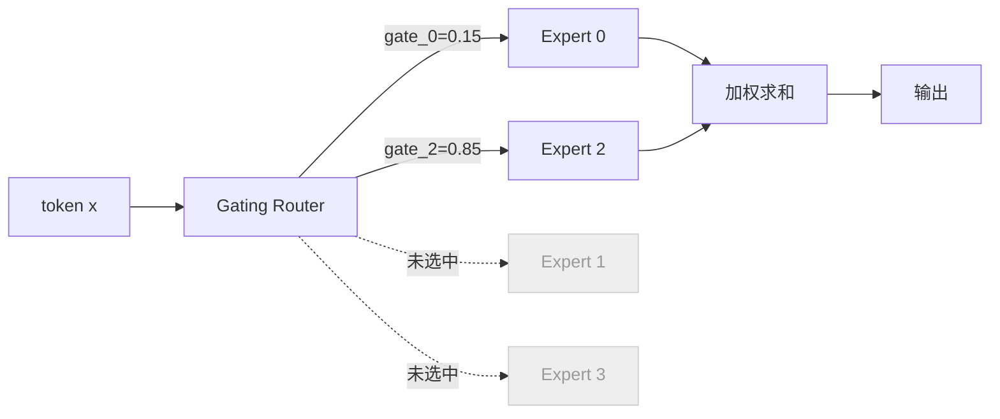
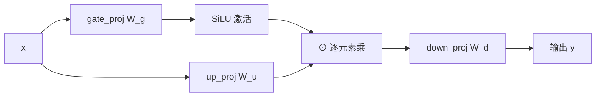
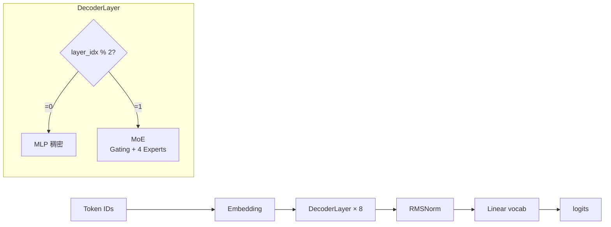
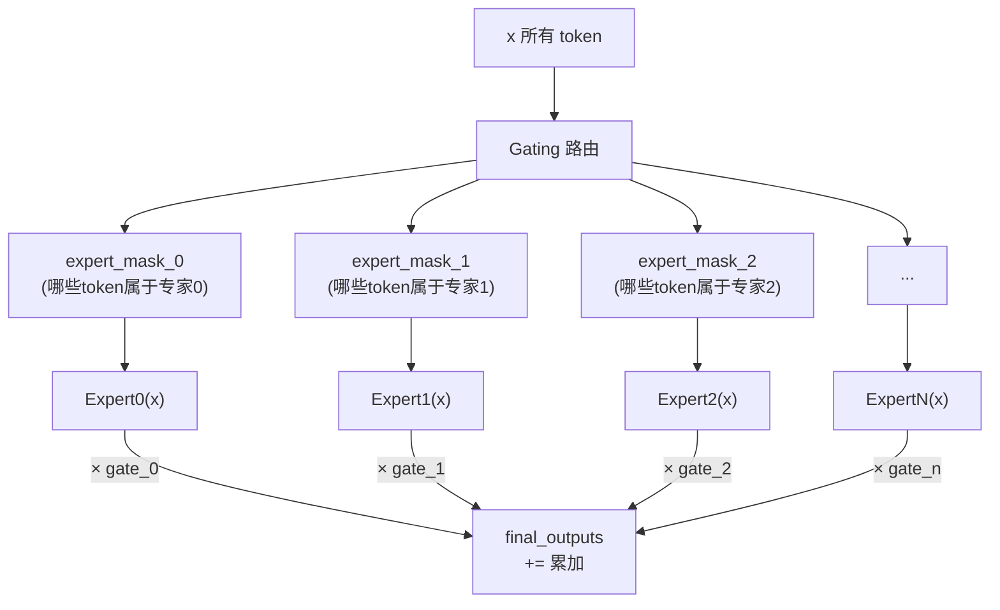
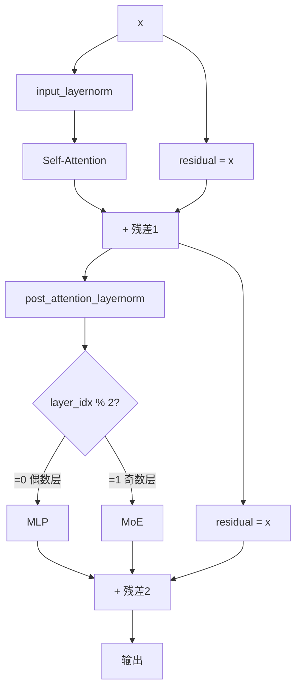
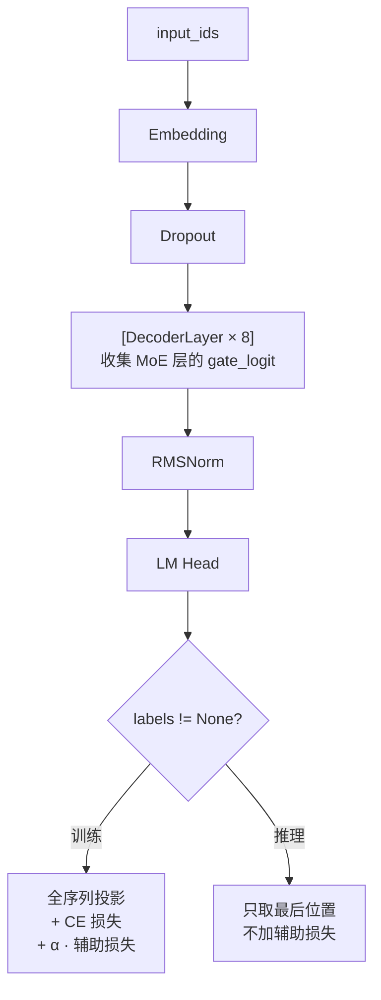
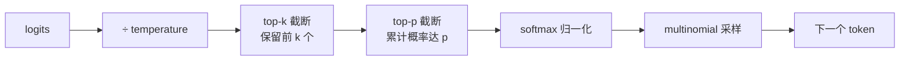
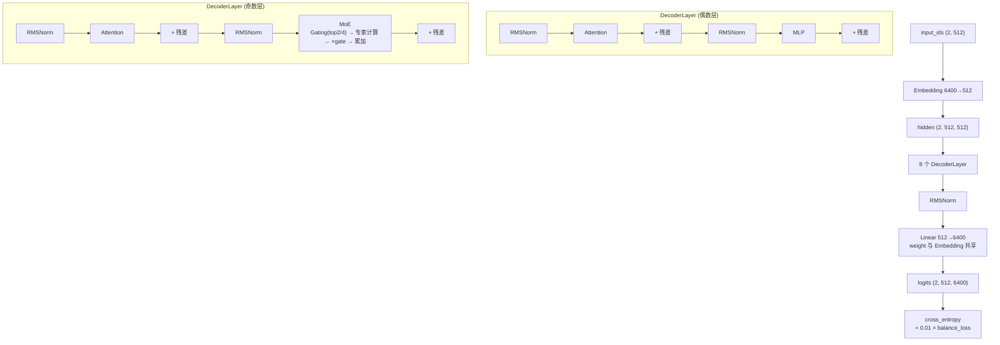

# 从零理解 MoE（Mixture of Experts）：原理、代码与工程优化全解析

> MoE（混合专家模型）是大模型扩展参数规模的核心架构——4 倍参数量，2 倍算力。Mixtral、DeepSeek、DBRX 等主流模型都基于它。
>
> 本文从「MoE 是什么」讲起，沿着**核心思想 → 三大组件 → 训练关键问题 → 代码实现 → 工程优化 → 训练推理细节**的脉络，把原理和代码层层剥开。遇到容易卡住的地方会停下来多说两句，数学推导不跳步，代码逐行有注释。

---

## 一、MoE 的核心思想

### 1.1 从一个直觉开始

想象一家医院有 4 个专科医生，每个病人进来后，分诊台判断该看哪 2 个科，被选中的医生各自诊断，最后按信任度加权——「80% 听内科，20% 听外科」。

MoE 做的就是这件事：模型里放多个「专家网络」，由「路由器」动态决定每个 token 交给哪些专家，再按权重合并结果。



### 1.2 为什么要这么做——MoE 的核心价值

稠密模型的瓶颈在于参数量和计算量绑死——参数翻倍，算力也翻倍。MoE 打破了这个绑定：

| 对比项 | 稠密模型 | MoE 模型（4 专家 top-2） |
|--------|----------|--------------------------|
| 总参数量 | 7B | 7B × 4 = 28B |
| 每个 token 激活的参数 | 7B | 7B × 2 = 14B |
| 计算量 | 7B FLOPs/token | 14B FLOPs/token |

4 倍参数量，只花 2 倍算力——参数多带来更强的表达力，稀疏激活控制住了计算成本。

### 1.3 MoE 不是什么

容易混淆的三件事：
- **不是集成学习**：集成是多个独立模型投票，MoE 是一个模型内部的子网络由路由器动态选择
- **不是多任务学习**：每个专家不对应特定任务，分工是训练中自发形成的
- **不是 Dropout**：Dropout 随机丢弃，MoE 是有选择地激活

### 1.4 MoE 的发展脉络

MoE 的思想最早可以追溯到 1991 年 Jacobs 等人的论文，但真正在大模型中大放异彩是近几年的事：

- **2021**：Google 提出 Switch Transformer，用 top-1 路由 + 辅助损失，把 MoE 推到了万亿参数规模
- **2022**：GShard 进一步改进负载均衡，引入 capacity factor（容量因子）控制每个专家最多接收多少 token
- **2023**：Mistral 发布 Mixtral 8x7B，证明 MoE 在开源模型中也能达到 Llama 级别效果，但推理成本只有 1/4
- **2024**：DeepSeek 系列引入共享专家 + 路由专家混合，MegaBlocks 让 MoE 训练效率追上稠密模型

本文的代码实现结构类似 Mixtral——偶数层用稠密 MLP，奇数层用 MoE，这是目前最主流的布局方式之一。

---

## 二、MoE 的三大组件

MoE 层由三部分组成：**路由器（Gating）决定分配、专家（Expert）执行计算、组合（Combine）加权求和**。逐个拆解。

### 2.1 路由器：Gating

路由器决定每个 token 交给哪些专家处理、权重各多少。结构很简单——一个线性层 + top-k 选择 + softmax 归一化：

```python
class Gating(nn.Module):
    def __init__(self, config):
        self.gate = nn.Linear(hidden_size, expert_num)  # hidden → expert_num

    def forward(self, x):
        logits = self.gate(x)                    # (batch, seq_len, expert_num) 原始分数
        logits_topk, indices = logits.topk(topk, dim=-1)  # 选出最大的 k 个
        zeros = torch.full_like(logits, float("-inf"))     # 屏蔽未选中的
        sparse_logits = zeros.scatter(dim=-1, index=indices, src=logits_topk)
        sparse_logits = F.softmax(sparse_logits, dim=-1)   # 只对选中的归一化
        return sparse_logits, indices, logits
```

到这里你可能会想：为什么不先 softmax 再取 top-k，而要绕一圈先 top-k 再 softmax？

因为先 softmax 再 top-k，未选中专家的概率虽然低但仍然非零，后续做稀疏计算时会有数值残留。用 4 专家 top-2 的例子看就很清楚：

```
先 softmax 再 top-k:
  softmax([1.2, 0.5, 3.0, 0.8]) = [0.12, 0.06, 0.56, 0.26]
  → 专家0 和 专家1 仍有 0.12 和 0.06 的残留

先 top-k 再 softmax:
  topk → [3.0, 1.2]，indices = [2, 0]
  scatter 填回 → [1.2, -inf, 3.0, -inf]
  softmax → [0.15, 0, 0.85, 0]
  → 未选中专家概率严格为 0，概率和恰好为 1
```

scatter 的作用是把这些分数**填回对应的专家位置**，这样你既知道概率值，也知道它们属于哪两个专家。

### 2.2 专家网络：Expert

每个 Expert 就是一个标准的 SwiGLU MLP，和稠密模型里的 FFN 完全相同：



```python
class Expert(nn.Module):
    def __init__(self, config):
        self.gate_proj = nn.Linear(hidden_size, intermediate_size)  # 512 → 2048
        self.up_proj = nn.Linear(hidden_size, intermediate_size)    # 512 → 2048
        self.down_proj = nn.Linear(intermediate_size, hidden_size)  # 2048 → 512

    def forward(self, x):
        return self.down_proj(F.silu(self.gate_proj(x)) * self.up_proj(x))
```

4 个 Expert = 4 个独立的 MLP，**参数不共享**。这就是 MoE 参数量翻倍的原因。

#### SwiGLU 拆解

专家内部的计算：

$$y = W_{down} \left( \text{SiLU}(W_{gate} \cdot x) \odot (W_{up} \cdot x) \right)$$

SiLU 定义为 $\text{SiLU}(z) = z \cdot \sigma(z)$。$z=2$ 时 SiLU ≈ 1.76，$z=-1$ 时 ≈ -0.27——允许小负值通过，梯度处处非零，比 ReLU 更平滑。

有个常见误解值得说清楚：`F.silu(self.up(x))` 不是 SwiGLU，那是普通 MLP。SwiGLU 里**只有 gate 支路带 SiLU，up 支路没有**：

| 写法 | 类型 |
|------|------|
| `F.silu(self.up(x))` → `down(silu(up(x)))` | 普通 MLP（GPT 风格） |
| `F.silu(self.gate(x)) * self.up(x)` → `down(silu(gate(x)) · up(x))` | **SwiGLU**（LLaMA 风格） |

gate 支路的 SiLU 输出充当「门控信号」，决定 up 支路的信息通过多少——这就是「门控」的含义。

### 2.3 组合：加权求和

token 的最终输出是选中专家的加权和：

$$\text{output} = \sum_{i \in \text{selected}} \text{gate}_i \cdot \text{Expert}_i(x)$$

举个例子。batch=1, seq_len=3, expert_num=4, topk=2：

```
token0: Gating → 选专家2(权重0.85)和专家0(权重0.15)
        输出 = 0.15 × Expert0(x₀) + 0.85 × Expert2(x₀)

token1: Gating → 选专家1(权重0.58)和专家3(权重0.42)
        输出 = 0.58 × Expert1(x₁) + 0.42 × Expert3(x₁)

token2: Gating → 选专家0(权重0.66)和专家3(权重0.34)
        输出 = 0.66 × Expert0(x₂) + 0.34 × Expert3(x₂)
```

同一个 token 会被多个专家处理，输出必须**累加**（`+=`），不是覆盖。

---

## 三、MoE 训练的关键问题——负载均衡

理解了 MoE 的三个组件后，我们来聊训练中最大的坑：**路由器会偷懒**。

### 3.1 路由器偷懒：路由坍塌

路由器没有任何约束时，训练过程中会自发地把大量 token 集中分给少数几个专家——因为这条路损失降得最快，梯度推着它往这个方向走。后果是：

- 少数专家过载，成为训练瓶颈
- 其余专家收不到 token，参数得不到梯度，等于白占显存（**专家坍缩 / expert collapse**）
- 有效专家数远小于名义数，MoE 退化成小模型

所以必须加一个辅助损失，告诉路由器「别把鸡蛋放一个篮子里」。

### 3.2 怎么衡量「均匀」

先不想公式，直觉上「均匀」是什么意思？4 个专家，理想情况是每个各处理 25% 的 token。如果某个专家拿了 70%，另外三个各 10%，那显然不均匀。

那怎么把这个直觉变成一个可优化的数值？最直接的想法是：**看每个专家拿到 token 的占比，算方差**——方差越大越不均匀，方差为 0 就是完美均匀。

方差是 $\mathrm{Var}(f) = \frac{1}{E}\sum_i (f_i - 1/E)^2$，其中 $f_i$ 是专家 $i$ 收到 token 的比例（$\sum f_i = 1$）。展开它：

$$\mathrm{Var}(f) = \frac{1}{E}\sum_i f_i^2 - \frac{1}{E^2}$$

把 $\sum f_i^2$ 解出来：

$$\boxed{\sum_{i=1}^{E} f_i^{2} = \frac{1}{E} + E \cdot \mathrm{Var}(f)}$$

这就把方差和平方和联系起来了——**最小化平方和，等价于最小化方差**。而平方和在代码里更好算：每个占比做平方再求和，一行搞定。

均匀分布时 $\mathrm{Var}=0$，平方和取最小值 $1/E$；全部 token 压在一个专家时平方和 = 1（最大）。用 4 个专家看：

| 负载分布 | 方差 | $\sum f_i^2$ | $E\sum f_i^2$ | 直觉 |
|----------|------|--------------|---------------|------|
| (0.25, 0.25, 0.25, 0.25) | 0 | 0.25 | **1.00** | 完美均衡 |
| (0.4, 0.3, 0.2, 0.1) | 0.0125 | 0.30 | 1.20 | 稍偏 |
| (0.7, 0.1, 0.1, 0.1) | 0.0675 | 0.52 | 2.08 | 严重倾斜 |
| (1, 0, 0, 0) | 0.1875 | 1.00 | 4.00 | 全压一个 |

注意最后一列乘了 $E$——这是工程上的归一化，让损失值在「完美均衡」时恒等于 1（不管几个专家），调超参时不用因专家数不同而重调。

从梯度视角也能看出它为什么能自平衡：对可导的软概率 $p_i$ 求偏导，$\partial\mathcal{L}/\partial p_i = 2p_i$——热门专家梯度大被压，冷门专家梯度小被抬，天然就把分布往均匀方向推。

### 3.3 一个必须解决的问题：硬计数不可导

到这里你可能发现了——$f_i$ 是 top-k 硬选择数出来的「计数」，top-k 本质上是 argmax，对 logits 几乎处处梯度为 0。如果直接拿计数算损失，梯度传不到路由器，这个正则就白加了。

解决方法：用 softmax 后的路由概率取平均来替代硬计数：

$$p_i = \frac{1}{T}\sum_{t=1}^{T} \text{softmax}(\text{logits}_t)_i$$

$p_i$ 是可导的（softmax 对 logits 可导），且 $\sum_i p_i = 1$，前面关于最小值的推导一字不改。所以实际做法是：前向用 $p_i$ 近似 $f_i$，反向走 $p_i \to$ logits 的可导路径。

这也解释了代码里为什么同时统计两个量：`tokens_per_expert`（硬，看真实负载）和 `router_prob_per_expert`（软，提供梯度）。

### 3.4 两种辅助损失形式

上面推出来的平方和 $\sum f_i^2$ 是一种形式。Switch Transformer / Mixtral 官方用的是另一种：$E\sum f_i P_i$，其中 $f_i$ 是硬选中比例，$P_i$ 是 softmax 概率平均。

区别在哪？乘积形式使得惩罚**只在「既想去又真去了」时才重**——概率高但没被选中（竞争激烈），乘积不大，惩罚轻。平方和只看占比，更纯粹但也更粗暴。

| 维度 | 平方和 $\sum f_i^2$ | Switch 乘积 $E\sum f_i P_i$ |
|------|----------------------|------------------------------|
| 需要的统计量 | 一个 | 两个（硬比例 + 软概率） |
| 最小值 | $1/E$，乘 $E$ 后为 1 | 均匀时也是 1 |
| 惩罚形状 | 二次，对头部敏感 | 双线性，更温和 |
| 典型出处 | GShard 变体 | Switch Transformer、Mixtral |

两种最小值位置相同（均匀），惩罚曲线不同。没有绝对优劣，工程上 Mixtral 选了后者，部分自研实现选前者。

### 3.5 Router z-loss：防止 logits 膨胀

除了负载均衡损失，部分实现（如 ST-MoE）还会加一个 **z-loss**，惩罚路由器 logits 的绝对幅值：

$$\mathcal{L}_z = \frac{1}{T} \sum_{t=1}^{T} \left(\log \sum_{i=1}^{E} e^{z_i^{(t)}}\right)^2$$

为什么需要它？当 logits 幅值过大时，softmax 会在数值上接近 one-hot（某个专家概率接近 1，其余接近 0），导致：
- 梯度变得极小（softmax 饱和），负载均衡损失难以生效
- 混合精度训练中更容易出现舍入误差

z-loss 把 logits 的量级「拉」回来，让 softmax 的输出分布更平滑，梯度更健康。它和负载均衡损失互补——后者管「分得均不均」，前者管「分数有没有跑飞」。

完整的三项损失：

$$\mathcal{L}_{\text{total}} = \mathcal{L}_{\text{CE}} + \alpha_1 \cdot \mathcal{L}_{\text{balance}} + \alpha_2 \cdot \mathcal{L}_z$$

### 3.6 几个工程细节

1. **分母用 $Tk$ 不是 $T$**：$k>1$ 时每个 token 贡献 $k$ 次选中，归一化必须用总选中次数，否则 $\sum f_i \ne 1$
2. **系数 $\alpha$ 很小**：通常 $10^{-3} \sim 10^{-2}$。太大会让模型为了均匀而放弃有用的路由——本来某专家更擅长某类 token，被强行摊平
3. **只在训练时施加**：推理没有梯度，均衡约束无意义
4. **容量因子 capacity_factor**：GShard / Tutel 等实现会给每个专家设一个「容量上限」= $\text{capacity\_factor} \times T / E$，超过的 token 直接丢弃。这是在负载均衡损失之外的硬性约束——损失是「软」引导，容量因子是「硬」截断。MegaBlocks 通过变长块稀疏 kernel 绕开了这个超参（dropless MoE）

---

## 四、代码逐行实现

基于 `moe_train.py`（结构类似 Mixtral 的从零实现），逐层拆解。

### 4.1 整体架构



默认配置：hidden_size=512, 16 Q头 / 8 KV头(GQA), intermediate_size=2048, vocab_size=6400, 8层, 4个专家, topk=2。

### 4.2 Gating 路由器

```python
class Gating(nn.Module):
    def __init__(self, config):
        self.gate = nn.Linear(self.hidden_size, self.expert_num)

    def forward(self, x):
        logits = self.gate(x)
        logits_topk, indices = logits.topk(self.topk, dim=-1)
        zeros = torch.full_like(logits, float("-inf"))
        sparse_logits = zeros.scatter(dim=-1, index=indices, src=logits_topk)
        sparse_logits = F.softmax(sparse_logits, dim=-1)
        gate_logit = logits.view(-1, self.expert_num)  # 原始分数，给辅助损失用
        return sparse_logits, indices, gate_logit
```

三个返回值：`sparse_logits`（路由权重）、`indices`（选中专家编号）、`gate_logit`（原始分数，用于计算辅助损失的梯度）。

### 4.3 Expert

```python
class Expert(nn.Module):
    def forward(self, x):
        return self.down_proj(F.silu(self.gate_proj(x)) * self.up_proj(x))
```

和第二部分分析的一致：SwiGLU MLP，gate 支路带 SiLU，up 不带。

### 4.4 MoE 前向：路由 → 执行 → 加权求和

这是 MoE 的核心计算流程。教学版用 for-loop 逐专家处理，逻辑最清晰：



```python
class MoE(nn.Module):
    def forward(self, x):
        sparse_logits, indices, gate_logit = self.gating(x)
        final_outputs = torch.zeros_like(x)
        x_flat = x.view(-1, x.shape[-1])
        sparse_logits_flat = sparse_logits.view(-1, sparse_logits.shape[-1])

        for i, expert in enumerate(self.experts):
            expert_mask = (indices == i).any(-1)           # ① 哪些token属于专家i
            expert_mask_flat = expert_mask.view(-1)
            if expert_mask_flat.any():                      # ② 有token才算
                expert_input = x_flat[expert_mask_flat]
                expert_output = expert(expert_input)
                gate_scores = sparse_logits_flat[expert_mask_flat, i].unsqueeze(1)
                weighted_output = expert_output * gate_scores  # ③ 加权
                final_outputs[expert_mask] += weighted_output  # ④ 累加
        return final_outputs, gate_logit
```

两个操作值得展开：

**① `(indices == i).any(-1)`**：`indices` 形状 `[batch, seq_len, top_k]`，逐元素比较后再在 $k$ 维做逻辑或——「这个 token 的 $k$ 个选择里，只要有一个是专家 $i$，就标记为 True」。一个 token 只需被某个专家处理一次，所以用 `any` 不用 `sum`。

**② `if expert_mask_flat.any()`**：空专家直接跳过。训练早期大量专家一个 token 都分不到，跳过是最朴素的性能优化。

$k=2$ 的例子：某 token 路由到专家 0 和专家 2，gate 分数 0.7 / 0.3。迭代 i=0 时算 `out_0 × 0.7` 累加，迭代 i=2 时算 `out_2 × 0.3` 再累加，最终 = 0.7·out₀ + 0.3·out₂。

### 4.5 负载均衡损失

```python
def load_balancing_loss_func(gate_logits, num_experts, top_k):
    concatenated_gate_logits = torch.cat([layer_gate for layer_gate in gate_logits], dim=0)
    routing_weights = F.softmax(concatenated_gate_logits, dim=-1)
    _, selected_experts = torch.topk(routing_weights, top_k, dim=-1)
    expert_mask = torch.nn.functional.one_hot(selected_experts, num_experts)
    tokens_per_expert = torch.mean(expert_mask.float(), dim=0)  # 硬比例 f_i
    router_prob_per_expert = torch.mean(routing_weights, dim=0)  # 软概率 P_i
    overall_loss = torch.sum(tokens_per_expert * router_prob_per_expert.unsqueeze(0))
    return overall_loss * num_experts
```

这就是第三部分讲的 Switch Transformer $E\sum f_i P_i$ 形式。同时统计硬选中比例（度量真实负载）和软概率（提供可回传的梯度），最后乘 $E$ 归一化到 1。

三个易错点：`expert_mask.float()` 必须转 float（`one_hot` 默认 long，`mean` 会报错）；$k$ 个槽位最后被 sum 掉；各层形状不一致时 `cat` 会报错。

### 4.6 DecoderLayer：交替 MLP / MoE



```python
class DecoderLayer(nn.Module):
    def forward(self, hidden_states, use_kv_cache):
        residual = hidden_states
        hidden_states = self.input_layernorm(hidden_states)
        hidden_states = self.self_attn(hidden_states, use_kv_cache=use_kv_cache)
        hidden_states = residual + hidden_states

        residual = hidden_states
        hidden_states = self.post_attention_layernorm(hidden_states)
        if self.layer_idx % 2 == 0:
            hidden_states = self.mlp(hidden_states)
            gate_logit = None
        else:
            hidden_states, gate_logit = self.moe(hidden_states)
        outputs = residual + hidden_states
        return outputs, gate_logit
```

这里有个命名陷阱：`post_attention_layernorm` 容易被读成「对 Attention 输出做后置归一」，但它的实际角色是 **FFN/MoE 的前置归一**。叫 post_attention 只是说它在结构中的位置在 Attention 之后，不是在描述它的功能。Pre-LN 的规则是每个子模块各配一个前置 norm，Attention 和 FFN 是两个并列的独立子模块，输入分布不同，不能共用。

为什么交替而不是每层都用 MoE？省参数、保留稠密层的稳定特征底座、只有 MoE 层返回 `gate_logit`（稠密层返回 `None`）。

顺便说一个 Mixtral 常见的误解：Mixtral 8×7B 的参数量是 **46.7B 而非 56B**。为什么？因为共享层（Embedding、Attention、RMSNorm）只算一份，MoE 层的专家参数才翻倍。8 层中 4 层是共享 Attention + MoE FFN，另外 4 层是共享 Attention + 稠密 FFN，所以实际是 2×7B（共享部分）+ 6×7B（MoE 专家部分）≈ 46.7B。推理时每个 token 只走 top-2 专家，计算量等价于一个 12B 的稠密模型。

### 4.7 LLM 主模型 forward



```python
def forward(self, input_ids, labels, use_kv_cache=False):
    all_router_logits = () if self.config.output_router_logits else None

    hidden_states = self.tokon_embeddings(input_ids)
    hidden_states = self.dropout(hidden_states)

    for idx, layer in enumerate(self.layers):
        hidden_states, gate_logit = layer(hidden_states, use_kv_cache=use_kv_cache)
        if gate_logit is not None:
            all_router_logits += (gate_logit,)

    hidden_states = self.norm(hidden_states)

    if labels is not None:                            # 训练
        logits = self.output(hidden_states)
        self.loss = F.cross_entropy(logits.view(-1, V), labels.view(-1), ignore_index=0)
    else:                                             # 推理
        logits = self.output(hidden_states[:, [-1], :])
        self.loss = None

    if self.config.output_router_logits:
        self.aux_loss = load_balancing_loss_func(all_router_logits, self.expert_num, self.topk)
        if labels is not None:
            self.loss += self.config.aux_loss_coef * self.aux_loss.to(self.loss.device)

    return CausalLMOutputWithPast(self.loss, logits)
```

总损失：$\mathcal{L} = \mathcal{L}_{\text{CE}} + \alpha \cdot \mathcal{L}_{\text{balance}}$，$\alpha \sim 0.01$。

几个要点：
- 训练时全序列投影算损失，推理时只取最后位置预测下一个 token
- `ignore_index=0`：label 为 0 的位置不算损失（padding / prompt mask）。HF 生态更常用 `-100`，更安全
- 辅助损失只在训练时加
- Weight Tying：嵌入矩阵和输出层共享参数，减少参数量

---

## 五、工程优化——从教学代码到生产实现

### 5.1 for-loop 实现的四个结构性缺陷

第四部分的 for-loop 实现理解原理很好，但无法用于大规模训练：

| 缺陷 | 原因 | 后果 |
|------|------|------|
| kernel 启动次数 = 专家数 | 每个专家一次 GEMM，每次启动 CUDA kernel | 小矩阵利用率低，启动开销占比高 |
| 负载不均衡 | 各专家分到的 token 数差异巨大 | GPU 难以满载 |
| 形状不规则 | 要么丢 token，要么补零 | 丢 token 不可导，补零浪费算力 |
| 不支持专家并行 | 没有 all-to-all 通信 | 无法多卡扩展 |

### 5.2 GEMM：MoE 性能的核心概念

先理解一个关键概念。**GEMM = GEneral Matrix Multiplication**，通用矩阵乘法。`nn.Linear` 底层就是 GEMM，大模型的算力几乎全花在它上面。

| 术语 | 含义 |
|------|------|
| GEMM | 矩阵 × 矩阵（算术强度高，GPU 容易打满） |
| GEMV | 矩阵 × 向量（batch=1 退化，带宽受限） |
| element-wise mul | 逐元素 `*`，不是 GEMM |
| 稠密 GEMM | 每个元素都参与，cuBLAS 主场 |
| 块稀疏 GEMM | 只有指定块参与，MegaBlocks 主场 |

MoE 的性能瓶颈就在这里：路由把大 GEMM 打碎成一堆小 GEMM，小 GEMM 算术强度低、受带宽限制，GPU 算力闲置。**MoE 性能优化的本质：如何把碎片重新拼成大 GEMM。**

### 5.3 MegaBlocks：块稀疏 GEMM 与 Dropless MoE

MegaBlocks 是 MoE 的生产级实现库（Mixtral、DBRX、DeepSeek 系列广泛使用），核心：**不丢 token、不补 padding，把循环 E 次小 GEMM 变成一次打包的块稀疏大 GEMM。**

| 传统 for-loop | MegaBlocks |
|---|---|
| Expert0: GEMM(小矩阵) | 重排 token → 连续成块 |
| Expert1: GEMM(小矩阵) | ↓ |
| Expert2: GEMM(小矩阵) | **一次块稀疏 GEMM（大矩阵）** |
| Expert3: GEMM(小矩阵) | ↓ |
| 4 次 kernel 启动 | 反重排 + 加权 |
| GPU 利用率低 | **1 次 kernel 启动** |
| — | GPU 利用率高 |

**Step 1 · 路由重排（permute）**：把 token 按「所属专家」重新排布，使同一专家的 token 连续成块：

| 原始排列 | 路由重排后 |
|----------|-----------|
| token0 → 专家2 | [token0, token2] → 专家2 块 |
| token1 → 专家5 | [token3] → 专家1 块 |
| token2 → 专家2 | [token1] → 专家5 块 |
| token3 → 专家1 | — |

**Step 2 · 一次块稀疏 GEMM**：把这些块当作稀疏矩阵的非零块，定制 kernel 一次性算出所有专家的结果。kernel 内部按块布局调度——线程块只处理「专家 $j$ 的 token × 专家 $j$ 的权重」。

**Step 3 · 反重排 + 加权求和（unpermute）**：把结果按原顺序打散回去，按 gate 分数加权累加。数学上和 for-loop 完全一致，只是执行方式不同。

「块稀疏」的精确含义：稀疏性以「整块」为单位——一段连续 token 只与对应的一段权重相乘。MoE 的路由天然就是这种结构化块稀疏，不是「随机稀疏」。通用稀疏库是给随机稀疏设计的，所以 MegaBlocks 自己写 kernel。

各方案对照：

| 方案 | 是否丢 token | 特点 |
|------|-------------|------|
| 教学 for-loop | 不丢（但极慢） | 只适合学习 |
| Tutel（微软） | 常需 capacity 上限 → 会丢 | 分组按容量对齐 |
| MegaBlocks | **不丢**（dropless） | 性能最好，去掉了 capacity_factor 超参 |
| 纯 padding | 不丢（但浪费算力） | 实现简单、显存浪费大 |

---

## 六、训练与推理细节

### 6.1 SFT 微调：标签掩码

SFT 只让模型学「怎么回答」，不学「怎么复述问题」：

```
prompt   : [1, 2, 3, 4]        ← "请翻译：hello"
answer   : [5, 6, 7]           ← "你好</s>"

input_ids: [ 1,  2,  3,  4,  5,  6,  7]
labels   : [×,  ×,  ×,  ×,  5,  6,  7]
           ↑ prompt mask     ↑ 只对回答算loss
          (ignore=-100)
```

Alpaca 格式：`instruction`（做什么）+ `input`（对什么做，可空）+ `output`（期望回答）。前两者进 prompt 但 mask 掉，只有 output 参与训练。

多轮对话中，所有「用户」段、历史「助手」段、以及「助手：」前缀全部 mask，只有最后一条助手回复正文（含 eos）算损失。历史回答也要 mask——它们是已知上下文，不是模型要生成的。

三个高频坑：eos 一定要算损失（否则模型学不会停下来）；不要 mask 得太狠（前缀被 mask、正文没 mask，模型会学成一上来就吐答案）；pad 位置的 label 必须是 ignore 值。

#### MoE 微调的特殊挑战

MoE 微调比稠密模型更容易过拟合——因为专家参数量大但激活稀疏，小数据集上专家容易「记住」训练样本而不是泛化。几个实用技巧：

- **对稀疏层用更高的 dropout**：MoE 层的 dropout 可以比稠密层更大，防止专家过拟合
- **小批量 + 高学习率**：MoE 的路由引入了额外的随机性，小 batch 让梯度估计更噪声化，配合稍高学习率效果更好
- **冻结 MoE 层**：实验表明，冻结 MoE 层只训练稠密层，效果几乎不掉——因为路由模式在预训练中已经学好了
- **指令微调对 MoE 提升更明显**：相比稠密模型，MoE 在指令微调后提升幅度更大，可能是因为专家能更灵活地适配不同类型的指令

#### 专家到底学到了什么

一个有趣的问题：不同专家有没有各自专精的领域？实证研究发现：

- **编码器侧**（如 BERT-MoE）：专家确实有分工——有的专注标点符号，有的专注专有名词，呈现语法层面的特化
- **解码器侧**（如 GPT-MoE）：专家几乎不分化，没有明显的语义分工——路由选择更像是「按 token 位置或上下文模式」而非「按主题」
- **多语言训练**：专家并不按语言分工。即使训练数据包含多种语言，也没有出现「英语专家」「中文专家」——专家的分工是隐式的、难以用人类可解释的语义类别来描述

这一点和直觉可能相反：你也许以为 MoE 的专家会像「专科医生」那样各管一摊，但实际上它们更像是「同科不同诊室」——分工存在但边界模糊。

### 6.2 推理生成：multinomial 采样

```python
idx_next = torch.multinomial(probs, num_samples=1)
```

multinomial = 多项分布采样，按概率抽签。`probs = [0.7, 0.2, 0.1]` → 0 号 70%、1 号 20%、2 号 10%。和 argmax（贪心）对比：argmax 确定但单调，multinomial 多样但可能抽到低概率怪词。

**输入必须是概率（≥ 0，和为 1），不是 logits。** 传 logits 会报错。

完整生成流程：



top-k / top-p 负责「改造分布」（把低概率置 0 并重新归一），真正的随机性来自 multinomial。

### 6.3 初始化策略：0.02/sqrt(2L) 的方差推导

| 参数 | 初始化 |
|------|--------|
| 所有 Linear、Embedding | $\mathcal{N}(0, 0.02^2)$ |
| 残差出口投影（`o_proj`、`up_proj`） | $\mathcal{N}\!\left(0, \left(\dfrac{0.02}{\sqrt{2L}}\right)^2\right)$ |

四步推导：

**第一步**：线性层 $y = Wx$，当 $W \sim \mathcal{N}(0, 0.02^2)$ 时，$\mathrm{Var}(y) = d_{in} \cdot 0.02^2 = 4096 \times 0.0004 \approx 1$。0.02 不是恒等，而是和 $d_{in} \approx 4096$ 配套的经验值。

**第二步**：残差让方差翻倍。$x_{\text{new}} = x + F(\text{Norm}(x))$，$\mathrm{Var}(x_{\text{new}}) \approx 1 + 1 = 2$。

**第三步**：每层两条残差支路（Attention + FFN/MoE），$L$ 层共 $2L$ 次累加。

**第四步**：出口投影缩 $1/\sqrt{2L}$，每次注入方差从 ≈1 降到 ≈$1/(2L)$，$2L$ 次累加后总增量 ≈ 1，不爆不塌。

| 不缩放 | 缩放 1/√(2L) |
|--------|---------------|
| Layer0: Var += 1 | Layer0: Var += 1/(2L) |
| Layer1: Var += 1 | Layer1: Var += 1/(2L) |
| ... | ... |
| **Layer L: Var ≈ 1+2L (爆炸)** | **Layer L: Var ≈ 1+1 = 2 (稳定)** |

为什么只缩放 `o_proj` 和 `up_proj`：只有它们是残差支路的最后一步投影，输出直接与主干相加。内部投影（q/k/v、gate、down）不直接进残差，缩放收益小。

一句话记忆：每条残差支路让方差 +1，一层两条共 $2L$ 条，出口投影缩 $1/\sqrt{2L}$ 把「逐层累积」压成「整体 ≈ 1」。

---

## 速查：易混概念对照

| 易混点 | 正确理解 |
|--------|----------|
| `post_attention_layernorm` | FFN 的**前置 norm**，不是对 Attention 输出做后置归一 |
| `F.silu(self.up(x))` | 普通 MLP；SwiGLU 里只有 gate 支路带 SiLU |
| `ignore_index=0` | 该位置不算损失；前提 pad_id=0，否则用 -100 |
| `multinomial` 输入 | 必须是概率，不是 logits |
| 平方和损失 | 最小 $1/E$（均匀），乘 $E$ 后归一到 1 |
| `f_i P_i` 损失 | 需要硬比例 + 软概率，最小值也是均匀处 |
| `(indices == i).any(-1)` | top-k 维做「或」：token 的 $k$ 个选择里是否含专家 $i$ |
| `if expert_mask_flat.any()` | 该专家是否分到至少一个 token |
| `+=` 累加 | top-k>1 时同一 token 需累加多个专家的加权输出 |
| 块稀疏 | 结构化块稀疏（段↔权重一一对应），非随机稀疏 |
| GEMM | 矩阵×矩阵；`*` 逐元素乘不是 GEMM |
| `0.02` | 与 $d_{in} \approx 4096$ 配套使 $d_{in}\sigma^2 \approx 1$ |
| `0.02/\sqrt{2L}` | 2 条残差 × L 层 = 2L 次累积的补偿 |

---

## 数据流全貌



**MoE 的核心价值**：4 个 Expert 总参数量 = 4× MLP，但每个 token 只激活 topk=2 个，实际计算量 = 2× MLP。用 4 倍参数量只花 2 倍算力。

---

## 参考

- [一文速览MoE及其实现：从Mixtral 8x7B到DeepSeekMoE](https://blog.csdn.net/v_JULY_v/article/details/145406756)（July）
- [混合专家模型 (MoE) 详解](https://huggingface.co/blog/zh/moe)（HuggingFace）
- [MoE 负载均衡与训练原理详解](https://zhuanlan.zhihu.com/p/18565423596)（知乎）
- [Switch Transformer 论文](https://arxiv.org/abs/2101.03961)
- [MegaBlocks 论文](https://arxiv.org/abs/2211.15841)
- [Mixtral of Experts 论文](https://arxiv.org/abs/2401.04088)
- [ST-MoE 论文（Router z-loss）](https://arxiv.org/abs/2202.08906)

---

*本文基于从零实现的 MoE 语言模型代码整理而成，结构类似 Mixtral。完整代码见 moe_train.py。*
